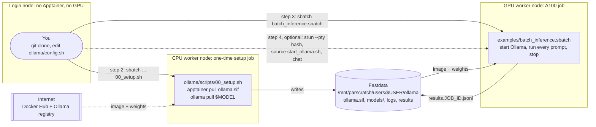
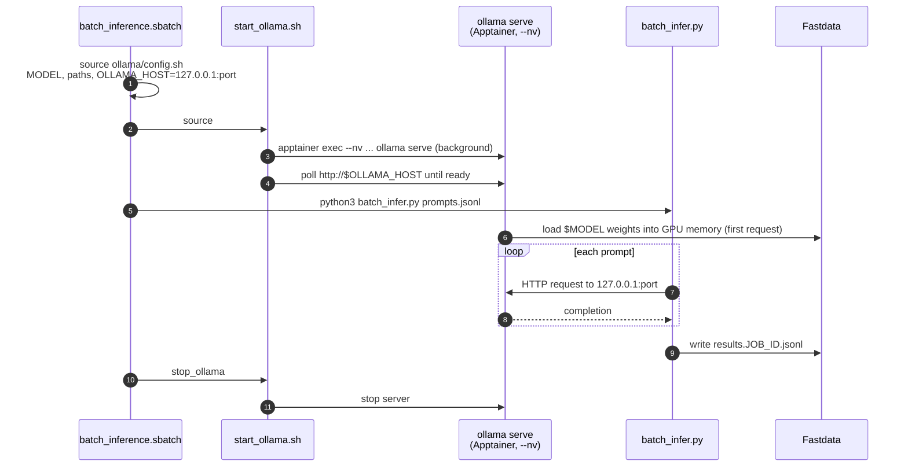

# Ollama on Stanage

An interactive-and-batch example: run an open-weight LLM (Llama, Qwen, Mistral,
gpt-oss, …) with [Ollama](https://ollama.com) inside an
[Apptainer](https://docs.hpc.shef.ac.uk/en/latest/stanage/software/apps/apptainer.html)
container on a Stanage GPU node. You go from *"I have a Stanage account"* to
*"I'm chatting with a model on an A100"* in about five commands.

Read the repository's [general information](../README.md) first, in particular
the [Security](../README.md#security) rules: **no restricted or sensitive data
on Stanage.** All commands below are run from the **repository root**.

## Why Ollama

- **Ollama** is the simplest way to run a model: one program, it downloads
  quantized models for you, and it serves a local API.
- **Apptainer** is preinstalled on Stanage's worker nodes (not the login
  nodes) and needs no root — we *pull* a ready-made image, so there is nothing
  to build or compile.
- **No dependency hell:** the container already contains CUDA, the GPU
  runtime, and Ollama.

For whole datasets (thousands of prompts or more) see the
[workflow examples](../workflows/README.md), which are typically several times
faster than Ollama on the same GPU.

## Security specific to this example

The general rules are in the [top-level Security section](../README.md#security).

On top of the cluster-wide prohibition, this example has two further
weaknesses, both explained below:

1. **The model API is unauthenticated**, and "localhost" does not mean
   "private to your job" on a shared node.
2. **Your data lands in plaintext on shared storage** — for batch jobs the
   results file (`$OLLAMA_DIR/results.*.jsonl`) contains every prompt and
   completion verbatim, and the server log (`$OLLAMA_DIR/server.*.log`)
   records the requests you made. Both live on fastdata, which is visible to
   every user on the cluster and has no encryption at rest and no backups.
   Directory permissions are the only thing keeping them to yourself — see
   [Who else can see my models and
   prompts?](#who-else-can-see-my-models-and-prompts) below. Nothing here
   deletes them for you.

### Who else can see my models and prompts?

**Short answer: your files go in a per-user directory on a filesystem shared by
the whole cluster, and the setup script now makes that directory private
(mode `700`) when it creates it. If your directory already existed, you may
need to fix it yourself — see below.**

The longer answer, because "shared" means two different things here:

- **`/mnt/parscratch` is a cluster-wide filesystem.** It's a single Lustre
  filesystem mounted on the login node and every worker node, and every Stanage
  user's data sits on it. That's not incidental — it's *why* this repo uses it:
  the setup job (which downloads the model) and the GPU node (which runs it)
  have to see the same files.
- **Your own subdirectory, `/mnt/parscratch/users/$USER`, is yours** — but it
  isn't private automatically. The Stanage docs note that this directory
  [doesn't exist by
  default](https://docs.hpc.shef.ac.uk/en/latest/hpc/filestore.html#fastdata-areas)
  and should be created as mode `700`, "only be accessible to you". Created
  under the usual default umask instead, it comes out mode `755` — **readable
  by every other user on the cluster.**

This matters more than "someone can see my model weights" (they're public
downloads anyway). The same directory holds your **prompts and completions in
plaintext**: `server.*.log` records every API request, and for batch jobs
`results.*.jsonl` contains every prompt and its completion verbatim.

#### What the scripts do about it

`ollama/scripts/00_setup.sh` creates each level of the fastdata area as mode `700`, and
sets `umask 077` so the files it writes are `600`. Because a directory can only
be traversed by someone holding its `x` bit, a `700` directory keeps everything
inside it private regardless of the individual file modes — which is the only
thing protecting a batch job's `--output` file, since SLURM opens that before
any of this repo's code runs.

**Directories that already exist are never modified.** A `755` area may be the
[public/private
layout](https://docs.hpc.shef.ac.uk/en/latest/hpc/filestore.html#fastdata-areas)
the Stanage docs also describe, and silently tightening a directory you chose to
share would break it. Instead, `00_setup.sh` and `start_ollama.sh` warn:

```
WARNING: /mnt/parscratch/users/me/ollama is mode 755 -- readable by other users.
```

To fix it, either run the `chmod` the warning prints, or re-run setup with the
opt-in flag:

```bash
STANAGE_FIX_PERMS=1 srun --mem=8G --cpus-per-task=2 --time=02:00:00 bash ollama/scripts/00_setup.sh
```

Check the result yourself at any point:

```bash
ls -ld /mnt/parscratch/users/$USER /mnt/parscratch/users/$USER/ollama
# want: drwx------
```

| Variable | Effect |
| --- | --- |
| `STANAGE_FIX_PERMS=1` | Make `00_setup.sh` strip group/other access under `$OLLAMA_DIR` and the Apptainer cache. Off by default. |
| `STANAGE_ALLOW_OPEN_FASTDATA=1` | Silence the permissions warning (e.g. you *intend* the area to be shared). |

For batch jobs, submit with `umask 077 && sbatch ollama/examples/batch_inference.sbatch`
if you want SLURM's own `llm-batch.*.out` file to be mode `600` too — the
`umask` inside the script can't affect a file SLURM has already opened.

#### What this does *not* fix

> [!IMPORTANT]
> Private directory permissions keep out **other unprivileged users**. They do
> nothing about system administrators or root, they don't encrypt anything at
> rest, they don't give you backups, and they can't un-share data someone
> already copied while the directory was open. Most importantly, they do **not**
> make this setup suitable for restricted or sensitive data — the [cluster-wide
> prohibition](../README.md#security) applies regardless of how you set your file modes.
>
> The checks read mode bits only. A POSIX ACL can grant access that `ls -ld`
> doesn't show, so if you have ever used `setfacl` here, verify with
> `getfacl /mnt/parscratch/users/$USER`.

### Why the API isn't private

> [!WARNING]
> Ollama's API has **no authentication** — anyone who can reach the port can
> use the model and read/write server state. Binding to `127.0.0.1` (the
> default here) only means the API isn't reachable from *other* nodes; it
> does **not** mean it's private to your job:
>
> - Apptainer shares the host's network namespace (no container network
>   isolation), so `127.0.0.1` inside the container is the same loopback
>   interface as the bare-metal node.
> - These example jobs don't request exclusive node allocation, so another
>   user's job can be co-scheduled on the same physical node — and,
>   depending on the cluster's SSH policy, other users may also be able to
>   log into that node directly, whether or not they have a job running on
>   it.
> - Either way, anyone who can reach that node's loopback interface can
>   reach your Ollama server with no credentials required.
>
> Never treat `127.0.0.1` binding as isolation. If you need to understand the
> exact exposure on Stanage, ask [Research Computing
> Support](https://docs.hpc.shef.ac.uk/en/latest/help.html#gsc.tab=0) about
> node exclusivity and the SSH access policy.
>
> `start_ollama.sh` and `00_setup.sh` enforce loopback binding anyway: if
> `OLLAMA_HOST` is overridden away from `127.0.0.1`/`localhost`/`::1`, they
> print a warning and refuse to start. Set `OLLAMA_ALLOW_NONLOOPBACK=1` to override at your own
> risk.
>
> `ollama/config.sh` picks the *port* per job (an OS-assigned free port, rather
> than a fixed one) so two jobs co-scheduled on the same node don't
> accidentally collide. This is collision avoidance only — it does **not**
> change anything above. A co-located user can still find your port with a
> few seconds of loopback port scanning.

---

## Prerequisites

A Stanage account and SSH access (see the [top-level README](../README.md#prerequisites)).

## Quick start

The whole workflow is two jobs: a one-time CPU job that downloads everything
into fastdata, then GPU jobs that run the model from those files with no
internet access needed.



### 1. Get the code and configure

On a **login node**:

```bash
git clone https://github.com/rcgsheffield/stanage-llm.git
cd stanage-llm
```

This repository is public, so cloning over HTTPS needs no GitHub account or
credentials. (The SSH form, `git@github.com:rcgsheffield/stanage-llm.git`,
fails with `Permission denied (publickey)` unless you have registered an SSH
key with GitHub from the cluster, so it isn't suggested for new accounts.)

The only file you might edit is [`config.sh`](config.sh) — mainly to
pick a different model (see [Choosing a model](#choosing-a-model)). Everything
large (the container image, model weights, logs, results) is stored under
`/mnt/parscratch/users/$USER` — Stanage's *fastdata* area — because your home
directory is capped at **50 GB** and fastdata is uncapped, fast, and visible
from the GPU nodes.

### 2. One-time setup (small CPU batch job)

From the login node, in the repo directory:

```bash
sbatch --mem=8G --cpus-per-task=2 --time=02:00:00 --wrap="bash ollama/scripts/00_setup.sh"
squeue --me                  # watch it
tail -f slurm-<job-id>.out   # follow progress
```

This pulls the Ollama container image (~1 GB) and pre-downloads your model's
weights into fastdata. It runs as a CPU-only batch job (no GPU, so it usually
starts quickly) because
[Apptainer is only installed on the worker nodes](https://docs.hpc.shef.ac.uk/en/latest/stanage/software/apps/apptainer.html),
not the login nodes. Using `sbatch` means a dropped SSH connection can't kill
a half-finished multi-GB download. The files it writes to fastdata are
readable by the GPU nodes, so your actual GPU job runs completely offline.
Re-running is safe; it skips work already done. (`srun` instead of
`sbatch ... --wrap=...` works too if you prefer to watch it in the foreground.)

### 3. Run your prompts as a batch job

Stanage's docs say [interactive GPU use is strongly
discouraged](https://docs.hpc.shef.ac.uk/en/latest/stanage/GPUComputingStanage.html)
and that GPU work should go through batch jobs, so this is the main workflow.
Put your prompts in a JSONL file, one `{"id": "1", "prompt": "..."}` per line
(see [`common/data/prompts.jsonl`](../common/data/prompts.jsonl)), then from the login
node:

```bash
sbatch ollama/examples/batch_inference.sbatch my_prompts.jsonl   # omit the file to use the sample prompts
squeue --me                                               # watch it
```

The job requests a GPU, starts the model, runs every prompt, writes
`results.<job-id>.jsonl` to `/mnt/parscratch/users/$USER/ollama/`, and exits.
Edit `--mem`/`--time` in the script to suit your model and dataset (batch jobs
may run up to 96 hours), and uncomment the `--mail-*` lines to be emailed when
it finishes. Pick a larger model with `MODEL=... sbatch ...` (after running
setup with the same `MODEL`).

### 4. Optional: short interactive smoke test

Use an interactive GPU session only to try a model or iterate on a prompt
before submitting a batch job — keep it **short (an hour or less)**. This is
the only interactive GPU use the Stanage docs endorse.

```bash
srun --partition=gpu --qos=gpu --gres=gpu:a100:1 --mem=82G --cpus-per-task=8 --time=00:30:00 --pty bash
```

This drops you into an [interactive shell](https://docs.hpc.shef.ac.uk/en/latest/hpc/scheduler/index.html#types-of-job) on a [GPU node](https://docs.hpc.shef.ac.uk/en/latest/stanage/GPUComputingStanage.html#gsc.tab=0) with one **A100 (80 GB)**.
Stanage has a single `gpu` partition and you pick the GPU type with
`--gres=gpu:TYPE:1`: `a100` (80 GB, used throughout this repo), `h100` or
`h100nvl` (94 GB). Avoid plain `--gres=gpu:1` unless you don't mind which
architecture you get; to accept A100 or H100 but not H100 NVL (often a
shorter queue), use `--gres=gpu:1 --exclude=gpu[31-35]`. `--qos=gpu` is required.

`--mem=82G --cpus-per-task=8` is the documented
[per-GPU minimum for an A100](https://docs.hpc.shef.ac.uk/en/latest/stanage/GPUComputingStanage.html)
(roughly a fair share of a node's host RAM and CPUs), so keep it even for small
models: interactive sessions otherwise default to only a few GB of host memory,
which can cause CPU-to-GPU transfer failures. Keep `--time` to about an hour
(`--time=00:30:00` is plenty for the tiny default model, `gemma3:270m`); bigger
requests queue longer (see [Selecting resources](#selecting-resources)). For an
H100 NVL (94 GB VRAM) the documented minimum is 96 GB host RAM and 12 CPUs:

```bash
srun --partition=gpu --qos=gpu --gres=gpu:h100nvl:1 --mem=96G --cpus-per-task=12 --time=01:00:00 --pty bash
```

Then, from the repo directory:

```bash
source ollama/scripts/start_ollama.sh
chat                              # interactive chat
chat "Explain PCA in two sentences."   # or a one-off prompt
```

`source` (not `bash`) matters — it starts the server in your shell and gives
you the `chat` and `stop_ollama` helpers. When you're done:

```bash
stop_ollama    # stop the server
exit           # leave the GPU session -> releases the GPU to others
```

> [!IMPORTANT]
> GPUs on Stanage are a shared, limited, and heavily contended resource — an
> idle interactive session still blocks other researchers' jobs from that GPU
> for your whole walltime, even if you've stopped using it. Don't hold one
> open "just in case" or leave a chat session running unattended; request only
> the time you need (see [Selecting resources](#selecting-resources) below)
> and exit as soon as you're done. See Stanage's [Choosing appropriate
> resources](https://docs.hpc.shef.ac.uk/en/latest/hpc/Choosing-appropriate-resources.html#gsc.tab=0)
> guidance for the general principle.

Forgetting to stop the server (or just walking away) keeps the GPU reserved
for the rest of your walltime. `OLLAMA_IDLE_TIMEOUT` (minutes, default `15`)
auto-quits after that long with no API activity — it stops the server and,
if you're in a SLURM job, cancels it too so the GPU goes back to the
scheduler. This is a safety net, not a substitute for stopping the session
yourself when you're done. Set it to `0` to disable, or override the
duration:

```bash
OLLAMA_IDLE_TIMEOUT=0  source ollama/scripts/start_ollama.sh   # disable
OLLAMA_IDLE_TIMEOUT=30 source ollama/scripts/start_ollama.sh   # override duration
```

---

## Choosing a model

Set `MODEL` before running the setup and start scripts. What limits the model
you can run is GPU memory (VRAM), not host RAM: an A100 has 80 GB, an H100 NVL
has 94 GB.

| `MODEL`           | Size (quantized) | Good for                              | Fits on              |
| ----------------- | ---------------- | ------------------------------------- | -------------------- |
| `gemma3:270m`     | ~300 MB          | Tiny default, quick smoke test        | Any GPU              |
| `llama3.1:8b`     | ~5 GB            | Fast, general chat                    | Any GPU              |
| `qwen2.5:14b`     | ~9 GB            | Stronger reasoning, coding            | Any GPU              |
| `gpt-oss:20b`     | ~14 GB           | Open-weight, strong general model     | Any GPU              |
| `llama3.3:70b`    | ~43 GB           | Highest quality                       | A100 80 GB or larger |

Sizes are weights only; leave VRAM headroom for the context (KV cache). Use
the same `--mem`/`--cpus-per-task` for all of them (see
[step 3](#selecting-resources)).

Override the default without editing any file — set it once and it flows
through every script:

```bash
export MODEL=qwen2.5:14b
sbatch --mem=8G --cpus-per-task=2 --time=02:00:00 --wrap="bash ollama/scripts/00_setup.sh"   # downloads that model
sbatch ollama/examples/batch_inference.sbatch my_prompts.jsonl
```

Browse the full catalogue at <https://ollama.com/library>.

### Selecting resources

The values above are starting points, not a formula — actual usage depends on
your model, prompt lengths, and how long you chat for.
Stanage's [Choosing appropriate resources](https://docs.hpc.shef.ac.uk/en/latest/hpc/Choosing-appropriate-resources.html#gsc.tab=0)
guidance is worth reading before running anything beyond a quick test:

- **Bigger requests queue longer.** `--mem`/`--time` are a reservation, not a
  measurement — the scheduler has to find a slot with *at least* that much
  free before your job can start. For GPU jobs, though, stay at or above the
  [documented per-GPU minimums](https://docs.hpc.shef.ac.uk/en/latest/stanage/GPUComputingStanage.html)
  (A100: 82 GB / 8 CPUs; H100 NVL: 96 GB / 12 CPUs) and keep `--time` short.
- **Watch the GPU.** Run `nvidia-smi` in the job to see GPU utilisation and
  VRAM use.
- **Know which kind of out-of-memory you hit.** Only raise `--mem` after a
  *host* OOM (the job is killed by SLURM). A *CUDA* OOM means the model doesn't
  fit in VRAM: use a smaller model or a bigger GPU.
- **Measure, don't guess.** After a job finishes, run `seff <job-id>` to see
  actual memory and time used, and size your next request from that.
- **Jobs are killed, not throttled, if they exceed a limit** — request
  comfortably above what `seff` shows, not exactly at it.


---

## Going further

Two extras live in [`examples/`](examples/):

### Query the API from Python

Ollama serves an **OpenAI-compatible** API on `http://$OLLAMA_HOST` (the port
is chosen per job — see [Security](../README.md#security) above — and printed by
`start_ollama.sh` as `==> Ready. The API is at http://$OLLAMA_HOST`), so your
existing code using the `openai` client works with only a changed `base_url`
(see [Security](../README.md#security) above for what that binding does and doesn't
protect against). Inside a GPU session or batch job, after `source ollama/scripts/start_ollama.sh`:

```bash
python3 ollama/examples/query_api.py "Draft a one-line commit message for a bug fix."
```

[`query_api.py`](examples/query_api.py) uses the `openai` client if it is
installed and otherwise falls back to the standard library — so it runs with no
extra installs.

### Batch inference over a dataset (no interaction)

The main workflow ([step 3](#3-run-your-prompts-as-a-batch-job)). The batch job requests a
GPU, runs every prompt in your JSONL file (default [`common/data/prompts.jsonl`](../common/data/prompts.jsonl)), writes answers to fastdata, and exits. The SLURM output
log itself also lands in `/mnt/parscratch/users/$USER/ollama/` — not the
directory you submitted from — so it stays with the rest of that run's
files:

```bash
sbatch ollama/examples/batch_inference.sbatch my_prompts.jsonl   # from the repo root, on a login node
squeue --me                                               # watch it
```

See [`examples/batch_inference.sbatch`](examples/batch_inference.sbatch) for the
SLURM resource request you'd adapt for larger runs (batch jobs may run up to
96 hours).

---

## Troubleshooting

| Symptom | Fix |
| --- | --- |
| `nvidia-smi` fails / model is very slow | You're not on a GPU or forgot `--nv`. Confirm you started the session with `--gres=gpu:a100:1 --qos=gpu`. |
| `no active SLURM job detected` when sourcing `start_ollama.sh` | You're on a login node. Grab a GPU session first (step 4 above), then source the script from inside it. |
| `no active SLURM job detected` when running `00_setup.sh` | You ran it directly on a login node. Launch it with `sbatch` (or `srun`) as shown in step 2. |
| `apptainer: command not found` / `'apptainer' not found` | You're on a login node, where Apptainer isn't installed (it's only on the worker nodes, and there's no module to load). Run it inside a job: `sbatch` for setup (step 2), a batch job (step 3) or short GPU session (step 4) for the model. |
| `image not found` / `command not found` for the model | Run setup first (step 2). |
| Out-of-memory / CUDA OOM | CUDA OOM: use a smaller `MODEL` or a bigger GPU (`--gres=gpu:h100nvl:1` for 94 GB). Host OOM (killed by SLURM): raise `--mem`. |
| First response is slow, then fast | Normal — the weights load from Lustre into VRAM on first use. |
| Home quota full | Confirm `OLLAMA_MODELS` points at `/mnt/parscratch/...` (it does by default). Never let Ollama write to `~/.ollama`. |
| Server won't start | Check the log printed at startup: `cat "$OLLAMA_LOG"` (e.g. `/mnt/parscratch/users/$USER/ollama/server.<job-id>.log`). |
| `WARNING: ... is mode 755 -- readable by other users` | Your fastdata area was created before this check existed, so other users can read your prompts and logs. Run the `chmod` the warning prints, or re-run setup (step 2) with `STANAGE_FIX_PERMS=1` in front. See [Who else can see my models and prompts?](#who-else-can-see-my-models-and-prompts). |

---

## How it fits together

Every script sources [`config.sh`](config.sh) first, so `MODEL`, the
fastdata paths and the API address come from one place. Inside a GPU job, the
batch script starts Ollama in the background, sends it every prompt over a
loopback-only HTTP API, and shuts it down again:



The interactive smoke test (step 4) uses the same `start_ollama.sh`; you just
type `chat` instead of running `batch_infer.py`. There, an idle watchdog stops
the server and cancels the job after `OLLAMA_IDLE_TIMEOUT` minutes with no API
activity, so a forgotten session gives the GPU back.
