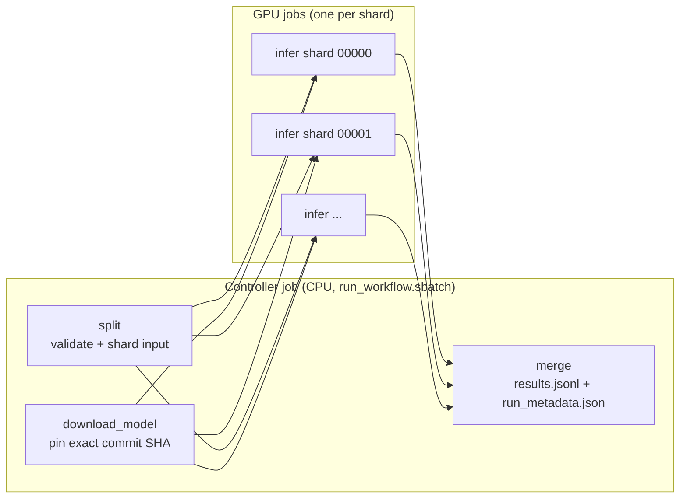

# Batch LLM inference at scale: Snakemake + vLLM

A batch-first alternative to the Ollama scripts in the repo root, for running
an open-weight LLM over **a dataset** of prompts: thousands to millions of
records, unattended, resumable.

| | Ollama path (repo root) | This workflow |
| --- | --- | --- |
| Best for | Trying a model, small batches, GGUF/quantised Ollama models | Datasets, reproducible research runs |
| Engine | `ollama serve` + one HTTP request per prompt | vLLM loaded **in-process**, whole shard in one call (continuous batching) |
| Throughput | Modest: Ollama doesn't do continuous batching | Typically several times higher on the same GPU |
| Scale-out | One GPU job | Input split into shards, one GPU job per shard, run in parallel |
| Failure | Rerun everything | Rerun only failed shards |
| Models | Ollama library tags (`llama3.1:8b`) | Hugging Face repo ids (`Qwen/Qwen2.5-7B-Instruct`) |

The same [Security](../../README.md#security) rules apply: **no restricted or
sensitive data** on Stanage. Prompts and results are written in plaintext under
`/mnt/parscratch/users/$USER/vllm/`, which setup creates as mode `700`.

## Why vLLM in-process, not a shared server?

Loading model weights takes seconds to minutes, so it's tempting to keep one
long-running server for many jobs to share. On a shared HPC cluster that
backfires:

- the server holds an idle GPU until its walltime runs out;
- its API has no authentication on a multi-user node;
- other jobs have to find it on whatever node it landed on.

Instead, each GPU job loads the model **once** and pushes thousands of prompts
through vLLM's offline `LLM` engine. The load time is a small fixed cost per
shard, and the GPU is released the moment the shard finishes.

## How it works



- **Controller**: [`run_workflow.sbatch`](run_workflow.sbatch) is a small CPU
  job running [Snakemake](https://snakemake.readthedocs.io/) with the
  [SLURM executor plugin](https://snakemake.github.io/snakemake-plugin-catalog/plugins/executor/slurm.html).
  It holds no GPU.
- **download_model** runs in the controller job and fetches the weights into
  `$HF_HOME` on fastdata. It resolves `revision` to an exact commit SHA, and
  every shard then loads that SHA **offline** (`HF_HUB_OFFLINE=1`).
- **infer** is the only rule submitted to SLURM: one GPU job per shard
  ([`scripts/infer.py`](scripts/infer.py)).
- **Every rule runs inside one pinned container**, the vLLM image set by
  `VLLM_IMAGE` in [`config/env.sh`](../../config/env.sh), so the whole run uses
  a fixed software stack.
- Changing the model, sampling or vLLM settings re-runs the affected shards.
  Unchanged, finished shards are never redone.

## Quick start

All commands run from the repo root on a Stanage **login node**.

**1. One-time setup** (CPU job, ~30–60 min, mostly pulling the ~10 GB image):

```bash
sbatch --mem=16G --cpus-per-task=4 --time=03:00:00 \
       --wrap="bash workflows/vllm-batch/scripts/setup.sh"
```

This pulls the vLLM image to `/mnt/parscratch/users/$USER/vllm/vllm.sif`. It
also creates a conda environment with Snakemake and its SLURM plugin
(`module load Miniforge3`).

**2. Run the bundled sample prompts** with the tiny default model:

```bash
sbatch workflows/vllm-batch/run_workflow.sbatch
squeue --me           # one llm-workflow job, plus a GPU job per running shard
```

Results land in `/mnt/parscratch/users/$USER/vllm/runs/default/`:

| File | Contents |
| --- | --- |
| `results.jsonl` | One line per input record, in input order: `id`, `prompt` (or `messages`), `response`, `finish_reason`, `prompt_tokens`, `completion_tokens` |
| `run_metadata.json` | Provenance: model + commit SHA, sampling and vLLM settings, container image digest, git commit of this repo, token totals |
| `logs/` | Per-step logs; `infer.NNNNN.log` reports model-load time and tokens/s |

**3. Your own data and model**:

```bash
sbatch workflows/vllm-batch/run_workflow.sbatch \
    --config input=/mnt/parscratch/users/$USER/data/my_prompts.jsonl \
             run_name=exp1 model=Qwen/Qwen2.5-7B-Instruct
```

Anything after the script name is passed to `snakemake`, so `-n` (dry run:
show what would run) and `--config key=value` both work. For settings you
reuse, edit [`config.yaml`](config.yaml) instead. Every key is documented
there.

## Input format

JSONL, one record per line, each with a unique `id` and either:

```json
{"id": "1", "prompt": "Summarise this abstract: ..."}
{"id": "2", "prompt": "...", "system": "You are a careful annotator."}
{"id": "3", "messages": [{"role": "system", "content": "..."}, {"role": "user", "content": "..."}]}
```

The existing [`examples/prompts.jsonl`](../../examples/prompts.jsonl) works as-is.
Bad JSON, missing fields and duplicate ids stop the run before any GPU is
requested.

## Choosing a model and GPU

vLLM loads Hugging Face **safetensors** repos, not Ollama/GGUF models. VRAM is
the limit: unquantised (bf16) weights take about 2 GB per billion parameters,
plus room for the KV cache.

| `model` | Weights | `gpu_type` / `n_gpus` |
| --- | --- | --- |
| `Qwen/Qwen2.5-0.5B-Instruct` (default) | ~1 GB | any / 1 |
| `Qwen/Qwen2.5-7B-Instruct` | ~15 GB | any / 1 |
| `Qwen/Qwen2.5-14B-Instruct` | ~30 GB | any / 1 |
| `Qwen/Qwen2.5-32B-Instruct` | ~65 GB | `h100nvl` / 1, or `a100` / 2 |
| `Qwen/Qwen2.5-72B-Instruct-AWQ` (4-bit) | ~40 GB | `a100` / 1 |

`n_gpus > 1` splits one model across GPUs (tensor parallelism). Only use it
when the model doesn't fit on one GPU. For more throughput on a model that
fits, use more shards instead: they run in parallel on separate GPUs.

**Gated models** (Llama, Gemma, ...): accept the licence on huggingface.co,
create a read token, and export it before submitting. SLURM passes your
environment through to the job:

```bash
export HF_TOKEN=hf_...      # or keep it in a mode-600 file and `export HF_TOKEN=$(cat ~/.hf_token)`
sbatch workflows/vllm-batch/run_workflow.sbatch --config model=meta-llama/Llama-3.1-8B-Instruct
```

The token is only used by the download step and never written to the logs or
results.

## Tuning

- **`shard_size`**: each GPU job pays the model-load cost once. Use shards of
  thousands of prompts for real runs. Keep each shard comfortably inside
  `runtime_min`. A failed shard is retried once with double the walltime.
- **Parallelism**: `jobs: 8` in
  [`profiles/stanage/config.yaml`](profiles/stanage/config.yaml) caps how many
  shard jobs are queued at once. It's a shared cluster; raise it with care.
- **Structured output**: set `json_schema` in `config.yaml` to force every
  response to be valid JSON matching the schema. Useful for classification and
  extraction.
- **Shared prompt prefixes** (a long instruction reused across records) are
  cached automatically (`enable_prefix_caching: true`).
- **Reproducibility**: `sampling.seed` is fixed by default, and the model
  commit and container digest are recorded. For the most deterministic output,
  set `temperature: 0`.

## Resuming and re-running

- **Controller hit its walltime, or a shard failed?** Resubmit the same
  command. Finished shards are kept, and only missing or failed ones run.
- **"Directory cannot be locked"** means an earlier controller was killed
  hard. Check `squeue --me` that it has really gone, then run the same
  command once with `--unlock` added, and once more without it.
- **A new experiment?** Use a new `run_name` so earlier results are kept.

## Upgrading vLLM

Change `VLLM_IMAGE` in [`config/env.sh`](../../config/env.sh) to a newer
digest from [Docker Hub](https://hub.docker.com/r/vllm/vllm-openai/tags), delete
`/mnt/parscratch/users/$USER/vllm/vllm.sif`, and re-run setup. The default is
a `-cu129` (CUDA 12.9) build, chosen because it runs on a wider range of host
GPU drivers than the CUDA 13 builds.
